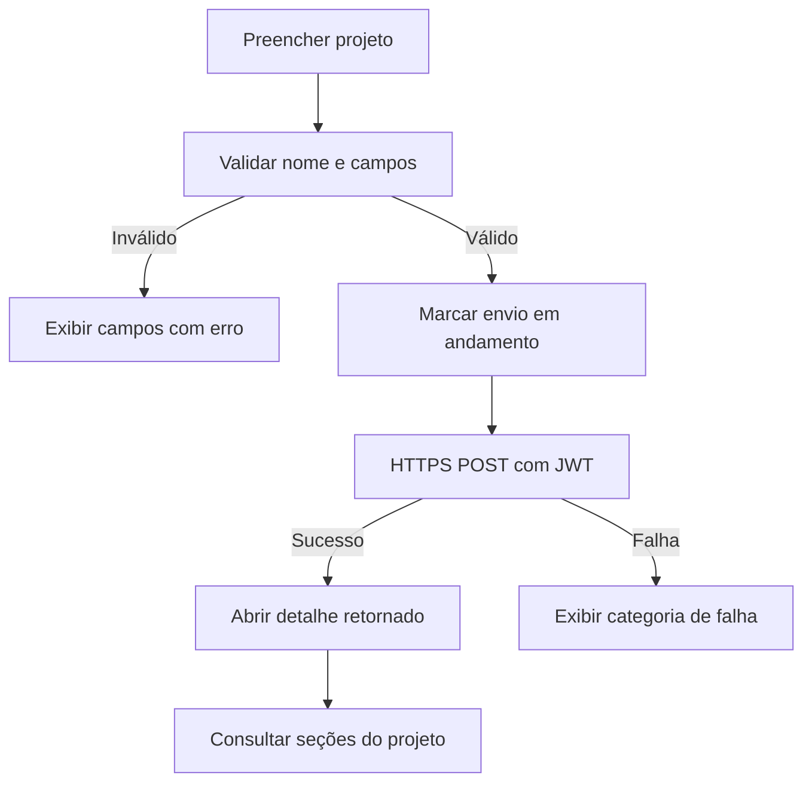

  

# Criação de projeto

A tela valida o rascunho e envia ao cadastro central, abrindo o id retornado.

## Falhas e limites

O ViewModel bloqueia uma nova submissão durante o envio, e a validação local não substitui a autorização do servidor. A localização é omitida quando todos os campos estão vazios, e uma falha não cria um projeto local substituto.

Fonte em [implementação](https://github.com/Solierrr/mobile-app/blob/main/app/src/main/kotlin/com/project/solaria_mobile/feature/project/NewProjectViewModel.kt).
