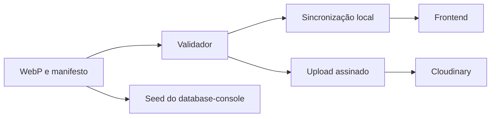

  

# Arquitetura

O catálogo `manifest.json` descreve arquivos em `images/`. Os scripts usam Node.js nativo, sem dependências de runtime.

`scripts/catalog.mjs` valida o catálogo. `sync.mjs` copia ao frontend e `cloudinary.mjs` publica no armazenamento. O upload usa HTTPS com assinatura e credenciais de ambiente. Não há banco próprio. A integração com os consumidores está no [mapa central](https://github.com/Solierrr/docs-warehouse/blob/main/docs/flows/INTEGRATIONS.md).
