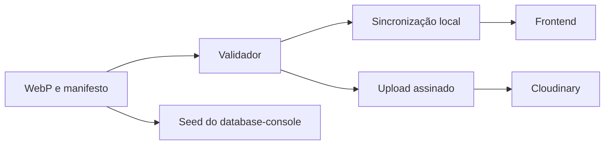

  

# Arquitetura

O catálogo `manifest.json` descreve arquivos em `images/`. Os scripts usam Node.js nativo, sem dependências de runtime.

O `scripts/catalog.mjs` valida o catálogo, o `sync.mjs` copia os arquivos para o frontend e o `cloudinary.mjs` publica no armazenamento, com upload por HTTPS assinado e credenciais do ambiente. O repositório não tem banco próprio, e a integração com os consumidores está no [mapa central](https://github.com/Solierrr/docs-warehouse/blob/main/docs/flows/INTEGRATIONS.md).