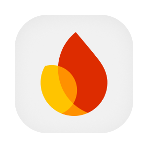

  

  
  
  
  

# Portal e operação web

O portal reúne a descoberta de produtos e profissionais e a operação das empresas da plataforma. A pessoa consulta o catálogo, administra seu perfil e acompanha conversas, projetos e compras. Empresas encontram áreas para ofertas, unidades, equipe e vendas, com acesso condicionado ao contexto e às permissões da conta.

A aplicação React usa serviços de identidade, cadastro, mensagens, assistentes e notificações. A sessão fornece o JWT das chamadas autenticadas e a comunicação em tempo real usa WebSocket. O Firebase participa da identidade federada e dos avisos no navegador. As integrações e os modos locais de dados são configurados durante a construção do aplicativo.

## Aprofunde-se no Projeto!

- [OVERVIEW.md](./docs/OVERVIEW.md), finalidade e regras de produto.
- [ARCHITECTURE.md](./docs/ARCHITECTURE.md), componentes, dados e integrações.
- [RUNNING.md](./docs/RUNNING.md), preparação e execução local.
- [DEPLOY.md](./docs/DEPLOY.md), ambientes e publicação.
- [STATUS.md](./docs/STATUS.md), limites observados.
- [LOGIN.md](./flows/LOGIN.md), detalhes do fluxo ou modelo de dados.
- [CHAT.md](./flows/CHAT.md), detalhes do fluxo ou modelo de dados.
- [PROFESSIONAL_SIGN_UP.md](./flows/PROFESSIONAL_SIGN_UP.md), detalhes do fluxo ou modelo de dados.
- [PROJECT_MANAGEMENT.md](./flows/PROJECT_MANAGEMENT.md), detalhes do fluxo ou modelo de dados.
- [PUSH_REGISTRATION.md](./flows/PUSH_REGISTRATION.md), detalhes do fluxo ou modelo de dados.
- [PENDENCIAS.md](./PENDENCIAS.md), questões para revisão.

## Contribuindo

- [CONTRIBUTING.md](https://github.com/Solierrr/.github/blob/main/.github/CONTRIBUTING.md), convenções de contribuição.
- [CODE_OF_CONDUCT.md](https://github.com/Solierrr/.github/blob/main/CODE_OF_CONDUCT.md), código de conduta.
- [SECURITY.md](https://github.com/Solierrr/.github/blob/main/SECURITY.md), relato de vulnerabilidades.
