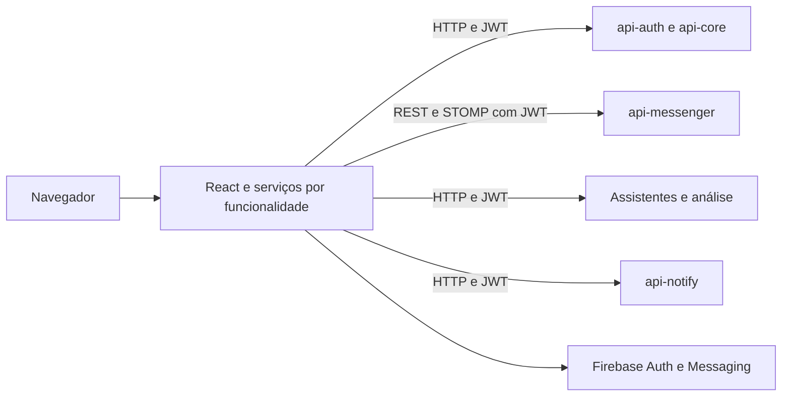

  

# Arquitetura

A aplicação usa React 19, TypeScript, Vite e React Router. O [mapa de rotas](https://github.com/Solierrr/web-app/blob/main/src/routes/AppRoutes.tsx) organiza acesso, catálogo e operação com guardas de sessão, empresa e administração.

| Pasta | Papel |
|---|---|
| `src/features/` | Páginas, serviços e modelos por domínio |
| `src/lib/` | Componentes locais, HTTP e utilitários compartilhados |
| `src/config/` | Internacionalização, Firebase, logs e modos de dados |
| `src/routes/` | Rotas e requisitos de navegação |
| `.storybook/` | Catálogo e configuração de componentes |

As integrações autenticadas usam JWT. O cliente HTTP e os utilitários de refresh coordenam a renovação. A sessão é armazenada em `localStorage`. O serviço de mensagens recupera histórico por REST e recebe eventos STOMP, incluindo digitação e presença.

O assistente chama `ai-assistant` ou `ai-operational`, conforme o fluxo. A análise de imagens chama `ai-accessibility`. Documentos podem usar `ai-validation` e o cadastro profissional no `api-core`. O catálogo de ofertas chama `/api/catalog/offers` no `api-core`, sem pressupor uso de `api-recommendation`.

Não foi encontrado acesso de escrita ao Firestore na main. A presença é tratada no cliente STOMP. Dados de domínio pertencem aos serviços de backend. Os fluxos entre serviços estão no [mapa central](https://github.com/Solierrr/docs-warehouse/blob/main/docs/flows/INTEGRATIONS.md).
