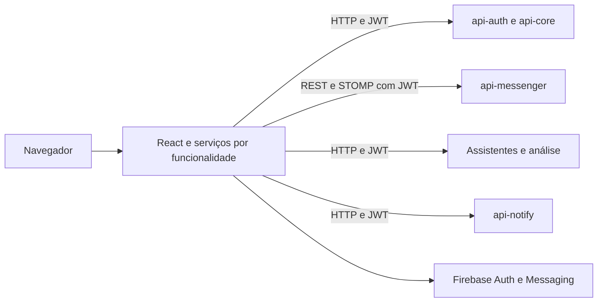

  

# Arquitetura

A aplicação usa React 19, TypeScript, Vite e React Router. O [mapa de rotas](https://github.com/Solierrr/web-app/blob/main/src/routes/AppRoutes.tsx) organiza acesso, catálogo e operação com guardas de sessão, empresa e administração.

| Pasta | Papel |
|---|---|
| `src/features/` | Páginas, serviços e modelos por domínio |
| `src/lib/` | Componentes locais, HTTP e utilitários compartilhados |
| `src/config/` | Internacionalização, Firebase, logs e modos de dados |
| `src/routes/` | Rotas e requisitos de navegação |
| `.storybook/` | Catálogo e configuração de componentes |

As integrações autenticadas usam JWT, com o cliente HTTP e os utilitários de refresh coordenando a renovação e a sessão armazenada em `localStorage`. O serviço de mensagens recupera o histórico por REST e recebe os eventos por STOMP, incluindo digitação e presença.

O assistente chama o `ai-assistant` ou o `ai-operational`, conforme o fluxo, e a análise de imagens chama o `ai-accessibility`, enquanto os documentos podem usar o `ai-validation` e o cadastro profissional no `api-core`. O catálogo de ofertas chama `/api/catalog/offers` no `api-core`, sem pressupor o uso do `api-recommendation`.

Não foi encontrado acesso de escrita ao Firestore na main, e a presença é tratada no cliente STOMP, já que os dados de domínio pertencem aos serviços de backend. Os fluxos entre serviços estão no [mapa central](https://github.com/Solierrr/docs-warehouse/blob/main/docs/flows/INTEGRATIONS.md).