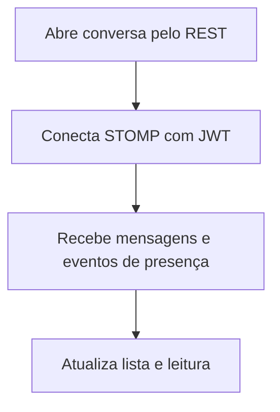

  

# Conversa e presença

O fluxo é iniciado pela pessoa na interface e depende das permissões da conta.

Erro de conexão exige reconexão e recuperação pelo REST. As mensagens e a presença não dependem de Firestore.

O contexto entre repositórios está no [mapa de integrações](https://github.com/Solierrr/docs-warehouse/blob/main/docs/flows/INTEGRATIONS.md).
