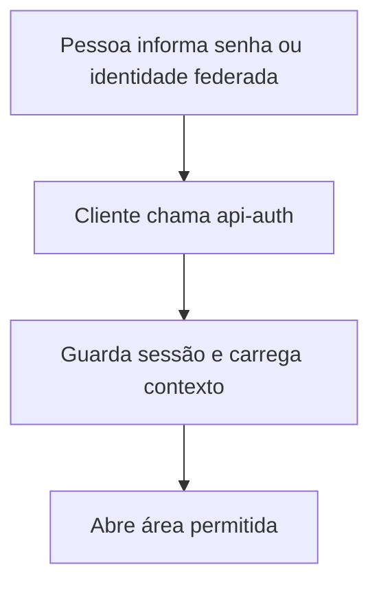

  

# Acesso à plataforma

O fluxo é iniciado pela pessoa na interface e depende das permissões da conta.

Falha de autenticação mantém a pessoa na tela de acesso. O refresh é coordenado para reduzir uso simultâneo do mesmo token.

O contexto entre repositórios está no [mapa de integrações](https://github.com/Solierrr/docs-warehouse/blob/main/docs/flows/INTEGRATIONS.md).
