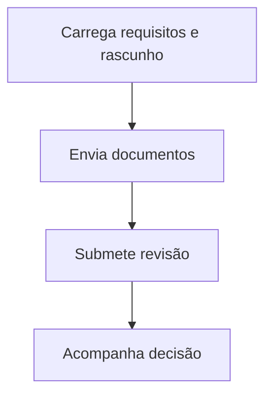

  

# Cadastro profissional

O fluxo é iniciado pela pessoa na interface e depende das permissões da conta.

Documento vazio, tipo não aceito ou tamanho acima de dez MiB é recusado no cliente. A autorização e a decisão final pertencem ao servidor.

O contexto entre repositórios está no [mapa de integrações](https://github.com/Solierrr/docs-warehouse/blob/main/docs/flows/INTEGRATIONS.md).
