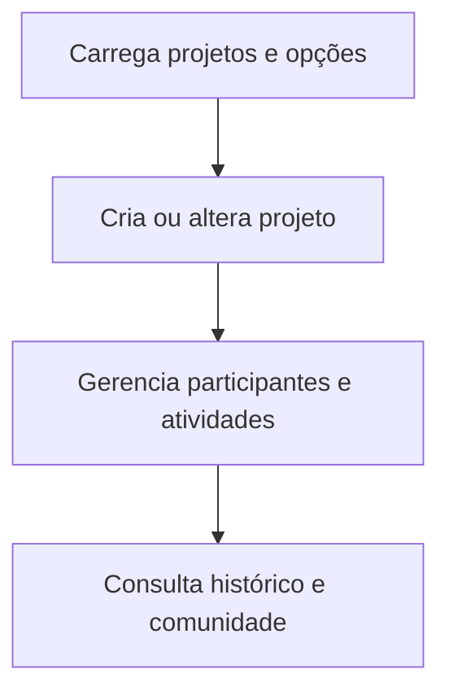

  

# Gestão de projeto

O fluxo é iniciado pela pessoa na interface e depende das permissões da conta.

Falhas de permissão e revisão do servidor devem ser apresentadas. A integração entre projeto e comunidade está no fluxo central.

O contexto entre repositórios está no [mapa de integrações](https://github.com/Solierrr/docs-warehouse/blob/main/docs/flows/INTEGRATIONS.md).
