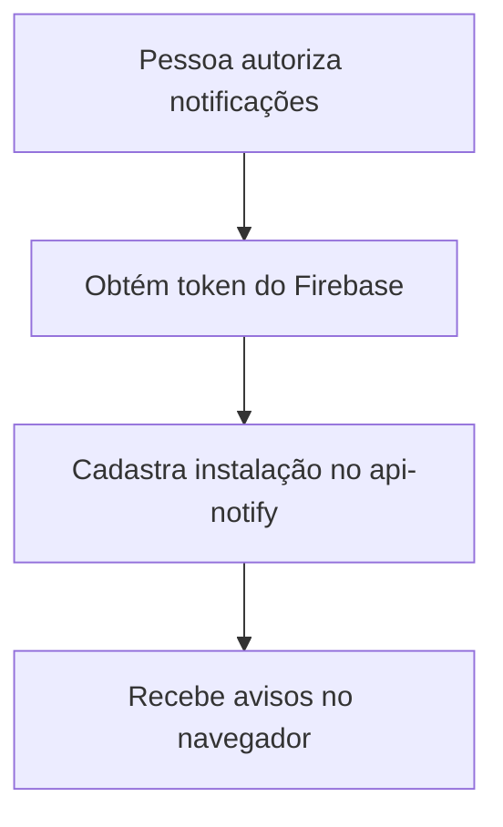

  

# Ativação de avisos

O fluxo é iniciado pela pessoa na interface e depende das permissões da conta.

Navegador incompatível, permissão bloqueada e chave VAPID ausente impedem ativação. A remoção da instalação é tratada na saída da conta.

O contexto entre repositórios está no [mapa de integrações](https://github.com/Solierrr/docs-warehouse/blob/main/docs/flows/INTEGRATIONS.md).
