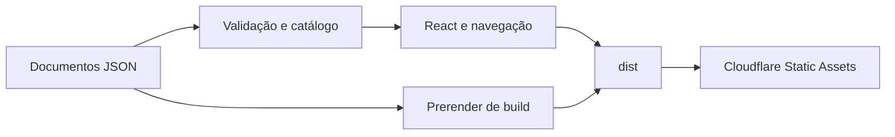

  

# Arquitetura

O portal usa React, TypeScript, Vite e uma biblioteca visual distribuída por tarball local. Os documentos são validados ao carregar pelo módulo de conteúdo.

| Pasta ou arquivo | Papel |
|---|---|
| `src/content/` | Conteúdo por documento e idioma, manifesto e rodapé |
| `src/config/content/` | Carregamento e fallback |
| `src/features/document/` | Tipos, validação e ícones |
| `src/components/` | Layout, sumário e navegação |
| `scripts-prerender.mjs` | HTML das rotas conhecidas e página 404 |
| `wrangler.jsonc` | Build, assets e domínio |

As seções exigem identificadores únicos. Links são limitados a esquemas e caminhos aceitos pela validação. O prerender possui lista fixa de documentos, independente do manifesto. Não há autenticação, banco ou API de negócio neste portal.
