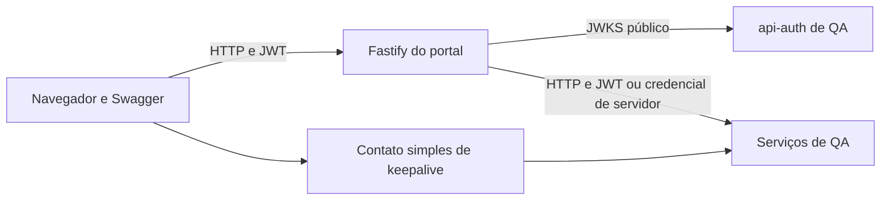

  

# Arquitetura

O frontend React é servido junto de um backend Fastify. O [catálogo permitido](https://github.com/Solierrr/web-sandbox/blob/main/shared/qa-services.json) limita os destinos do proxy.

`src/config/` mantém catálogo e configuração. `src/features/` organiza acesso, catálogo, keepalive e Swagger. `server/portal/` valida JWT, caminhos, credenciais e contratos. `shared/` fornece os destinos fixos.

O backend valida assinatura RS256, emissor, expiração e tipo access. O navegador não escolhe URLs arbitrárias. O proxy bloqueia redirecionamentos, referências OpenAPI externas e caminhos internos. O JWT passa entre abas por comunicação com validação de origem e identificação da aba.

Não há banco próprio. As credenciais específicas são injetadas apenas no servidor, segundo o mapa de `upstreamHeaders`. A compatibilidade com contratos atuais dos serviços precisa de confirmação. <!-- PENDENTE: 1 -->
