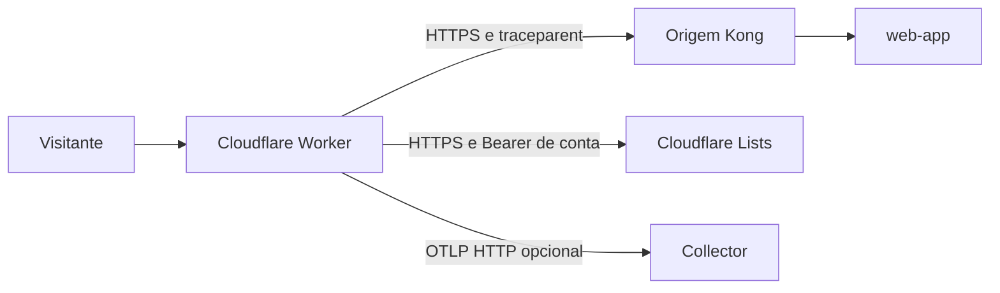

  

# Arquitetura

O [entrypoint](https://github.com/Solierrr/web-worker/blob/main/src/index.ts) implementa `fetch` e `scheduled`. O fluxo verifica honeypot, redirecionamento de idioma e origem, nessa ordem.

`src/i18n/` mantém o contrato portátil de rotas e idioma. `src/honeypot/` mantém detecção, inclusão e limpeza. `src/telemetry.ts` gera logs e spans. `scripts/` sincroniza snapshots a partir do aplicativo.

O Worker recusa origem igual ao host público para evitar recursão. A chamada à origem carrega `traceparent`. O envio de telemetria e a inclusão na lista usam `waitUntil`, sem bloquear a resposta. Não há banco próprio. A lista da Cloudflare é estado externo, e a deduplicação de tentativas é local ao processo.
