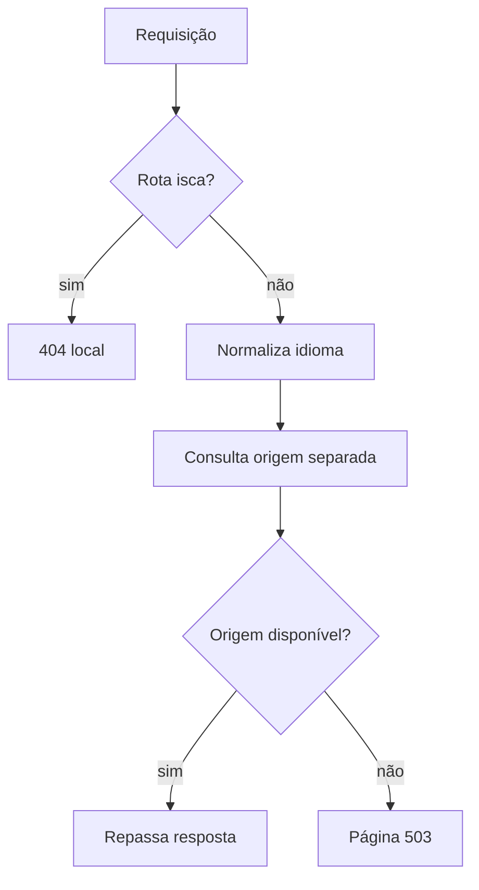

  

# Requisição de borda

A requisição passa por iscas e idioma antes da consulta à origem. Falha de conexão, resposta 5xx ou 404 específico de rota ausente no Kong produz página temporária 503.

O contexto de entrada da plataforma está no [mapa de integrações](https://github.com/Solierrr/docs-warehouse/blob/main/docs/flows/INTEGRATIONS.md).
