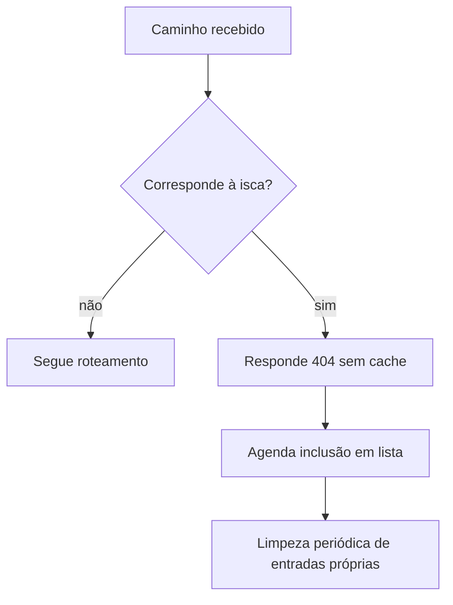

  

# Detecção de rotas isca

O caminho é normalizado, decodificado quando possível e comparado por prefixo sem distinguir caixa. Falhas ao registrar o IP não mudam a resposta local.

O contexto de entrada da plataforma está no [mapa de integrações](https://github.com/Solierrr/docs-warehouse/blob/main/docs/flows/INTEGRATIONS.md).
