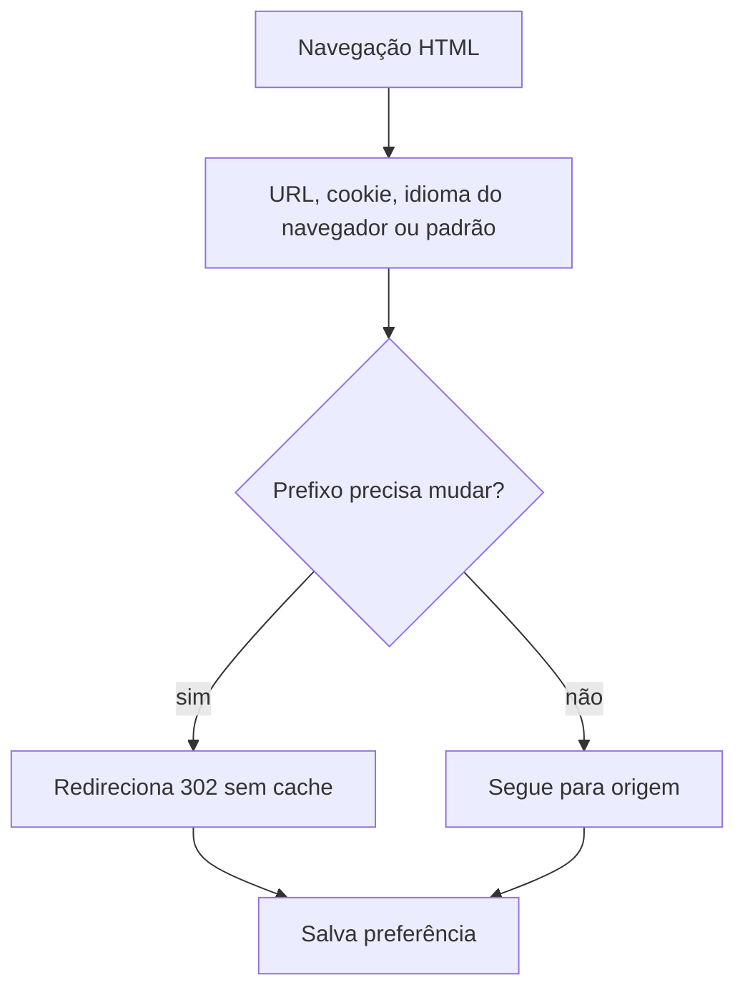

  

# Escolha de idioma

Somente navegações HTML GET e HEAD entram na normalização. APIs, arquivos, métodos de escrita e iscas são preservados.

O contexto de entrada da plataforma está no [mapa de integrações](https://github.com/Solierrr/docs-warehouse/blob/main/docs/flows/INTEGRATIONS.md).
