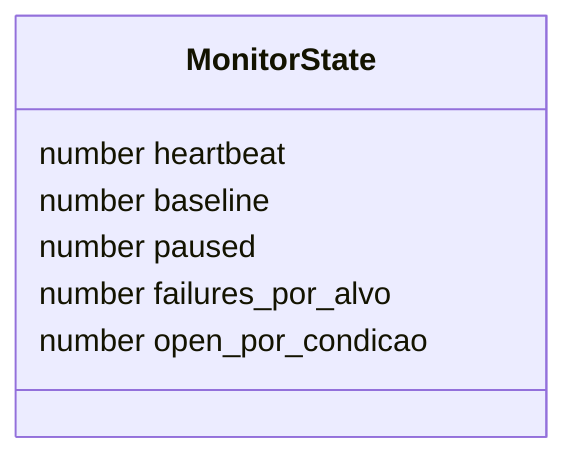

  

# Estado durável dos monitores

O [Wrangler](https://github.com/Solierrr/worker-alerts/blob/main/wrangler.jsonc) declara duas classes SQLite de Durable Objects. O código usa a API de storage chave-valor de `MonitorState`, sem DDL ou índices SQL próprios. O histórico de tickets pertence ao Jira e não é replicado neste storage.

## Coordenação por incidente

`INCIDENTS` seleciona uma instância de `IncidentCoordinator` pelo nome da chave do incidente. A chave contém doze caracteres hexadecimais derivados do alerta, serviço e ambiente. A implementação mantém uma cadeia de Promises em memória para executar as chamadas daquele incidente em série, inclusive depois de uma chamada falhar.

Esse objeto não grava histórico ou chave de ticket no storage. A deduplicação consulta o Jira. A migration SQLite da classe habilita o binding, mas não significa que o código tenha uma tabela de incidentes local.

## MonitorState

O binding `MONITOR` usa uma única instância com nome `main`. Os instantes são números em milissegundos desde o epoch.

| Chave armazenada | Conteúdo | Quem escreve e lê |
|---|---|---|
| `heartbeat` | Última batida recebida | `/heartbeat` escreve, monitor lê |
| `baseline` | Instante da primeira verificação | Monitor cria uma vez e consulta nas verificações |
| `paused` | Último instante em que uma pausa foi observada | Monitor e verificação de pausa do webhook escrevem, webhook lê |
| `failures:<nome>` | Número de falhas consecutivas por alvo | Monitor incrementa em falha e zera em resposta boa |
| `open:heartbeat` | Instante de abertura da condição de heartbeat | Monitor cria na falha e remove na recuperação |
| `open:probe:<nome>` | Instante de abertura da condição da sonda | Monitor cria na falha e remove na recuperação ou pausa |

Os nomes dos alvos vêm de [targets.json](https://github.com/Solierrr/worker-alerts/blob/main/src/monitor/targets.json), e o storage não tem TTL, limpeza periódica, índice adicional nem cópia local do conteúdo dos alertas. A pausa não limpa o contador `failures:<nome>`, como mostra a implementação em [state.ts](https://github.com/Solierrr/worker-alerts/blob/main/src/monitor/state.ts).

## Consistência e acesso

A API pública não permite consultar nem apagar esse storage diretamente, e o `/monitor/run` devolve um relatório calculado que pode alterar as condições registradas, a mesma lógica que o cron executa.

As leituras e escritas de cada chave são individuais. O código não estabelece uma transação conjunta entre storage do monitor e Jira nem uma exclusão global entre duas execuções do monitor. As limitações operacionais estão em [STATUS.md](../docs/STATUS.md).
