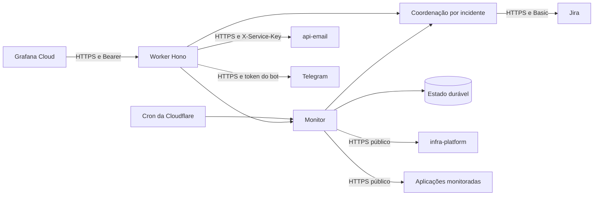

  

# Coordenação de alertas

O Worker separa entrada HTTP, normalização, coordenação por incidente, clientes de saída e monitoramento. Hono expõe as rotas, Zod valida o corpo e a configuração, e Durable Objects concentram a execução de cada incidente e a persistência do monitor. O Jira é a fonte do histórico dos tickets.

## Código

As fontes estão na `main` do repositório.

| Caminho | Papel |
|---|---|
| [src/index.ts](https://github.com/Solierrr/worker-alerts/blob/main/src/index.ts) | Rotas Hono, limites de entrada, despacho por incidente e evento agendado |
| [src/config.ts](https://github.com/Solierrr/worker-alerts/blob/main/src/config.ts) | Validação das variáveis e ativação dos canais |
| [src/ingest/](https://github.com/Solierrr/worker-alerts/blob/main/src/ingest/model.ts) | Autenticação, schema e normalização do alerta |
| [src/incident/](https://github.com/Solierrr/worker-alerts/blob/main/src/incident/service.ts) | Intervalos, histórico, conteúdo e recuperação |
| [src/channels/jira/](https://github.com/Solierrr/worker-alerts/blob/main/src/channels/jira/client.ts) | Jira REST v3 e conteúdo ADF |
| [src/channels/email/](https://github.com/Solierrr/worker-alerts/blob/main/src/channels/email/client.ts) | Elegibilidade e entrega do e-mail |
| [src/channels/telegram/](https://github.com/Solierrr/worker-alerts/blob/main/src/channels/telegram/client.ts) | Texto e envio do aviso pelo bot do Telegram |
| [src/monitor/](https://github.com/Solierrr/worker-alerts/blob/main/src/monitor/monitor.ts) | Heartbeat, sondas e estado do cluster |
| [src/routing/](https://github.com/Solierrr/worker-alerts/blob/main/src/routing/routing.ts) | Snapshot de destinos, nomes e hosts |

## Integrações

Cada entrada tem seu próprio mecanismo de autenticação.

| Origem | Destino | Protocolo e autenticação | Finalidade |
|---|---|---|---|
| Grafana Cloud | Worker | HTTPS com Bearer compartilhado | Alertas e heartbeat |
| Operação | Worker | HTTPS com o mesmo Bearer | Prévia e monitoramento manual |
| Worker | Jira | HTTPS REST v3 com Basic da conta de serviço e token | Buscar, criar, comentar, relacionar e marcar tickets |
| Worker | `api-email` | HTTPS com `X-Service-Key` | E-mail opcional após o ticket |
| Worker | Telegram | HTTPS com o token do bot | Aviso opcional após o ticket, fora do cluster |
| Worker | `infra-platform` | HTTPS público, sem credencial | Ler `ephemerality.json` na `main` |
| Worker | Alvos da sonda | HTTPS público, sem credencial | Conferir respostas HTTP |
| Script de sincronização | GitHub | API pela sessão da CLI `gh` | Ler `alerts.json` dos serviços |

O token de entrada é validado por comparação de hashes SHA-256 em tempo constante. Sem token configurado ou recebido, o acesso protegido é recusado. Essa entrada não usa JWT nem `X-Service-Key`. O contexto comum das chamadas entre serviços está em [autenticação entre serviços](https://github.com/Solierrr/docs-warehouse/blob/main/docs/flows/SERVICE_TO_SERVICE_AUTH.md).

## Incidentes e roteamento

A chave é formada pelos 12 primeiros caracteres hexadecimais do SHA-1 de `alert_id`, `service_name` e `deployment_environment`, separados por `|`. Cada chave seleciona um `IncidentCoordinator` que executa as chamadas em série. O objeto não guarda histórico de tickets em storage. Esse histórico é consultado no Jira pelo rótulo `inc-key-<chave>`.

O snapshot [routing.json](https://github.com/Solierrr/worker-alerts/blob/main/src/routing/routing.json) mapeia os serviços para os espaços `DEV`, `DB` e `AI`, com o tipo `Critic`. Serviços desconhecidos usam o espaço padrão. `names` fornece nomes de exibição e `hosts` fornece links HTTPS. Esses aliases não alteram a chave do incidente.

Os arquivos `alerts.json` dos serviços e [routing.shared.json](https://github.com/Solierrr/worker-alerts/blob/main/src/routing/routing.shared.json) alimentam o snapshot por [sync-routing.mjs](https://github.com/Solierrr/worker-alerts/blob/main/scripts/sync-routing.mjs). O script recusa aliases repetidos e projetos desconhecidos. O Worker usa apenas o snapshot no runtime, sem consultar repositórios para decidir o destino. O percurso completo está em [ROUTING_SYNC.md](../flows/ROUTING_SYNC.md).

## Dados e operação

O binding `MONITOR` mantém heartbeat, baseline, falhas e incidentes abertos em Durable Objects. O modelo e os acessos estão em [DURABLE_OBJECTS.md](../database/DURABLE_OBJECTS.md).

O cliente Jira usa timeout de dez segundos. E-mail, Telegram, sondas e leitura do estado do cluster usam oito segundos. Redirects externos não são seguidos. A API responde 503 quando o Jira falha no webhook para permitir nova tentativa do Grafana. Falhas ao relacionar tickets após a criação retornam avisos, sem desfazer o ticket.

Os logs registram ações e códigos de falha, sem corpo de resposta do Jira nem credenciais. O `wrangler.jsonc` habilita observabilidade da Cloudflare. A aplicação expõe `/health`, sem consultar dependências, e não publica `/ready`, OpenAPI ou versão HTTP. Essas diferenças estão em [STATUS.md](./STATUS.md).
