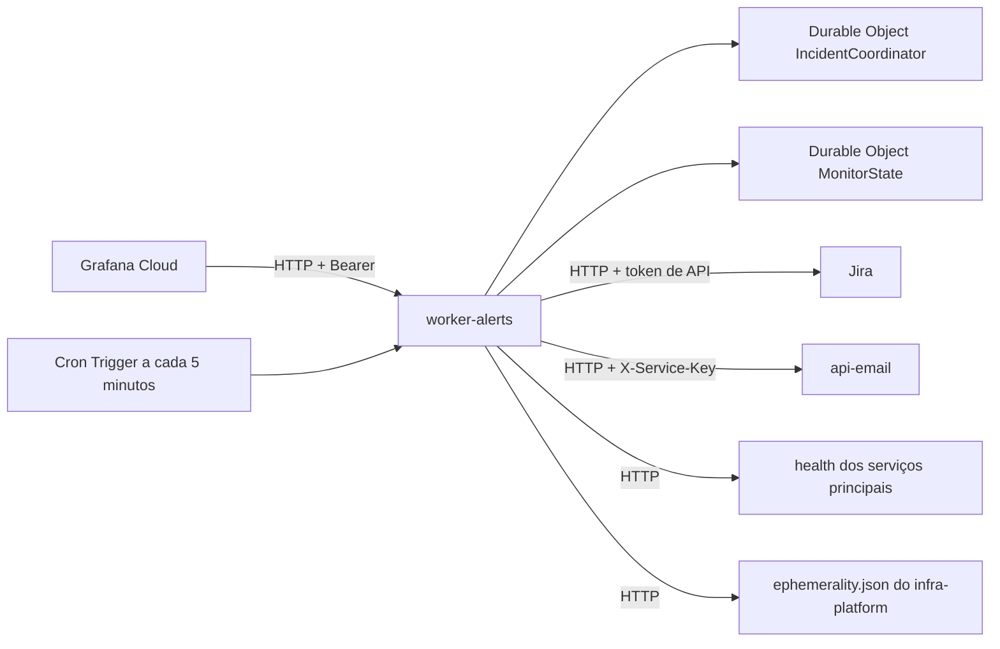

  

# Arquitetura

O serviço é um Cloudflare Worker em TypeScript, com as rotas montadas em Hono e as entradas validadas com Zod. Ele roda na borda da Cloudflare, e não no cluster, porque precisa continuar avisando a equipe justamente quando o cluster cai ou é desligado para economizar custo. O estado de cada incidente fica no próprio Jira, consultado por etiqueta antes de qualquer criação, e o Worker guarda apenas o necessário para organizar os avisos e acompanhar o heartbeat.

## Pastas

| Pasta | O que guarda |
|---|---|
| `src/index.ts` | as rotas em Hono, a tarefa agendada e a exportação dos Durable Objects |
| `src/config.ts` | a leitura e a validação, com Zod, das variáveis do Worker |
| `src/ingest/` | a conferência do token, o schema do webhook e a conversão de cada alerta num incidente |
| `src/incident/` | as regras do ticket, os textos e o Durable Object que organiza os avisos de cada incidente |
| `src/channels/jira/` | o cliente do Jira e a montagem do corpo do ticket no formato ADF |
| `src/channels/email/` | a chamada ao `api-email` e a regra de quando o e-mail sai |
| `src/monitor/` | o heartbeat, a sonda dos serviços, o estado e a lista de alvos |
| `src/routing/` | a tabela que liga cada serviço ao seu quadro no Jira |
| `scripts/` | a sincronização da tabela de rotas a partir dos repositórios de cada serviço |

## Integrações

| Integração | Direção | Para quê |
|---|---|---|
| Grafana Cloud | recebe | os alertas por webhook e a batida do heartbeat, os dois com o mesmo token bearer |
| Jira | chama | a consulta, a criação e os comentários dos tickets, com a conta de serviço e o token de API |
| `api-email` | chama | o e-mail dos incidentes P1 e P2, com o modelo `operational-alert` e a chave própria do Worker |
| Serviços principais | chama | a sonda do `web-app`, do `api-core`, do `api-auth`, do `api-messenger` e do `api-email` |
| `infra-platform` | lê | o arquivo de efemeridade, que diz se o cluster está desligado de propósito |

## Dados

O Worker não tem banco próprio. O Durable Object `IncidentCoordinator` existe um por chave de incidente e serve só para que os avisos do mesmo incidente sejam tratados um de cada vez, enquanto o `MonitorState` guarda a última batida do heartbeat e as falhas seguidas da sonda. A chave do incidente é um SHA-1 do alerta, do serviço e do ambiente, o que faz o mesmo problema cair sempre no mesmo ticket.

## Decisões técnicas

- O serviço roda fora do cluster porque o aviso precisa sair quando o cluster cai, decisão registrada como D30 nas decisões de infraestrutura.
- O Jira é a fonte do estado do incidente, consultado pela etiqueta da chave, porque assim o Worker não precisa de banco e o ticket mostra a mesma verdade para quem atende.
- O Worker nunca fecha o ticket e só marca o fim com a etiqueta `inc-resolvido`, porque encerrar o trabalho é uma decisão de quem atendeu.
- Os quadros do Jira são do tipo gerenciado pela equipe, e por isso o Worker usa etiquetas no lugar de campos personalizados.
- O destino de cada serviço mora no `alerts.json` do repositório dele e vira um snapshot aqui, conferido no CI e todo dia, para que a mudança de destino passe por revisão no próprio serviço.
- Uma falha ao consultar ou criar no Jira responde 503, para que o Grafana tente de novo em vez de o alerta se perder.

## Erros, health e versão

As respostas de erro seguem o formato `application/problem+json`, com 401 para token inválido, 413 para envio acima de 256 KiB, 415 para formato errado, 422 para alerta fora do contrato e 503 quando o Jira não está configurado ou falha. A rota `GET /health` é pública e responde só se o Worker está no ar, e a versão segue o release do repositório.
