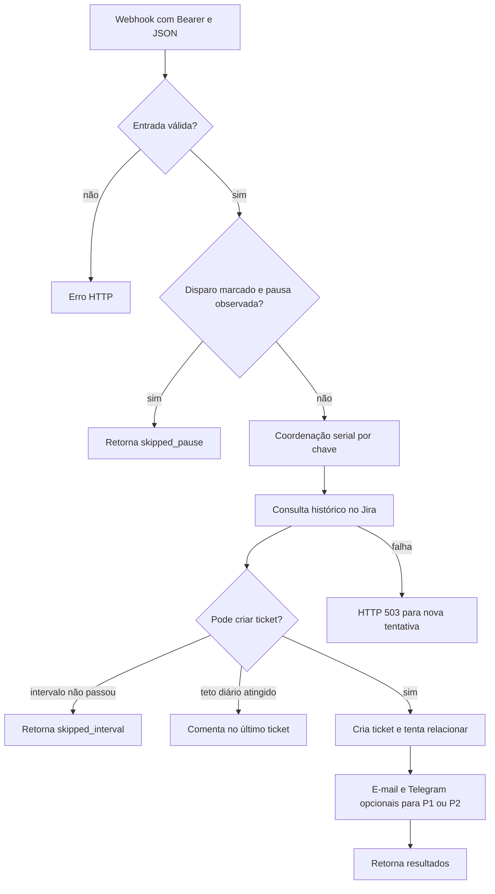

  

# Recebimento de alerta

O Grafana envia um lote ao webhook. O Worker valida a entrada, decide o efeito de cada incidente e devolve as ações. O e-mail elegível só é tentado depois que todos os incidentes do lote terminam sem falha de processamento. A implementação está em [index.ts](https://github.com/Solierrr/worker-alerts/blob/main/src/index.ts) e [service.ts](https://github.com/Solierrr/worker-alerts/blob/main/src/incident/service.ts).

## Casos de erro

Os resultados não desfazem as escritas de outros itens do lote.

- Token, corpo ou schema inválido interrompem a entrada com o erro descrito em [API.md](../docs/API.md).
- Falha de consulta ou criação no Jira devolve 503. O Worker não faz repetição interna.
- Falha ao relacionar tickets depois da criação aparece em `warnings`.
- Falha no e-mail ou no Telegram incrementa `email.failed` ou `telegram.failed` sem trocar o sucesso do webhook.
- Ambiente diferente produz `ignored_env`. A prévia usa uma rota separada e não verifica o histórico.

As convenções gerais de ligação estão no [mapa entre repositórios](https://github.com/Solierrr/docs-warehouse/blob/main/docs/flows/INTEGRATIONS.md).
