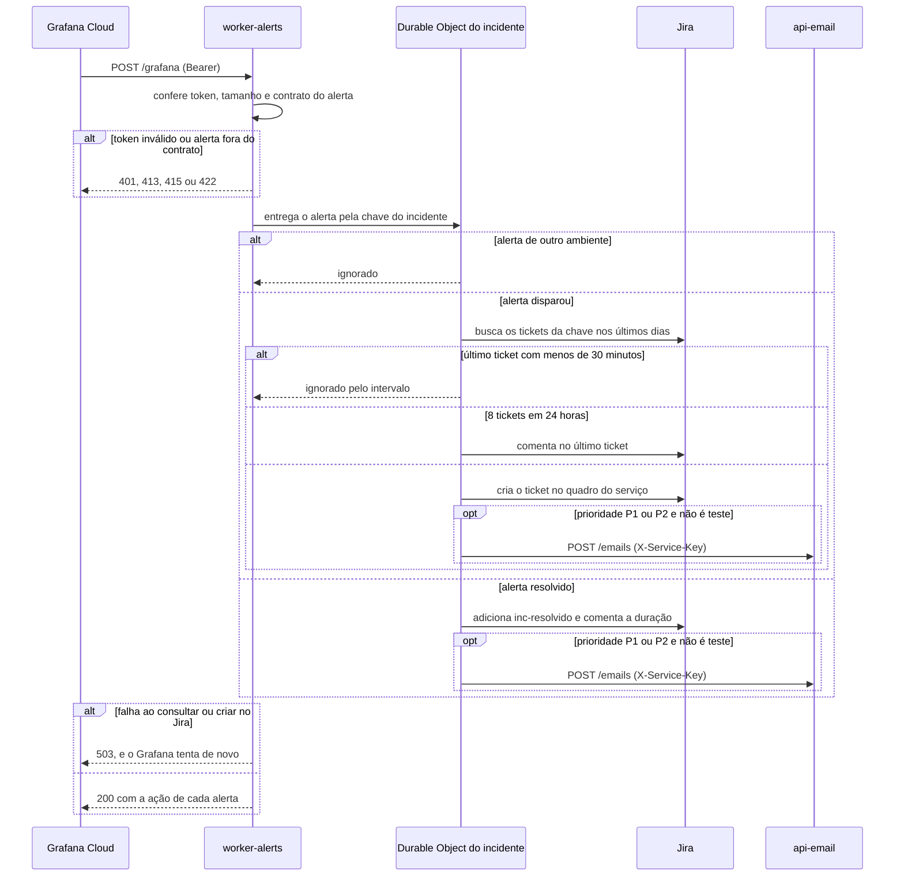

  

# Alerta que vira incidente

Acontece quando uma regra do Grafana Cloud dispara ou volta ao normal. O resultado é um ticket novo, um comentário no ticket existente ou o registro do fim do incidente no Jira, e um e-mail quando o incidente é P1 ou P2. Os avisos do mesmo incidente passam um de cada vez pelo Durable Object da chave, para que dois envios quase simultâneos não abram dois tickets.

