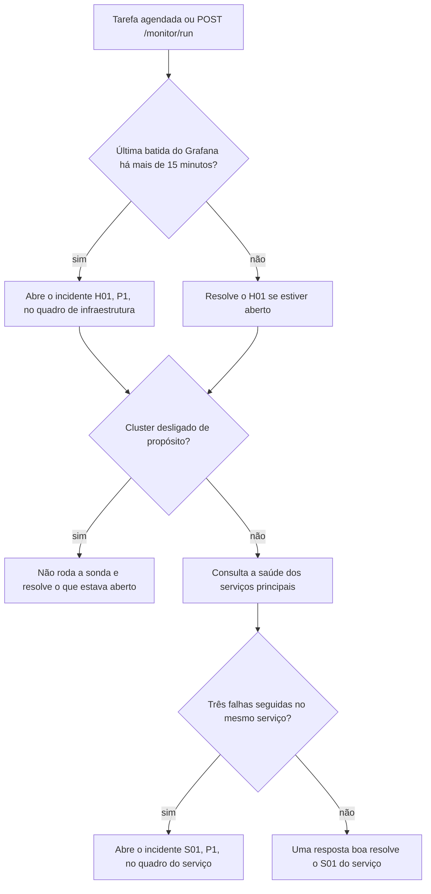

  

# Heartbeat e sonda

Acontece a cada cinco minutos, pela tarefa agendada, ou na hora, por `POST /monitor/run`. Os dois verificadores cobrem o caso em que ninguém avisa que o aviso parou, e os incidentes que eles abrem seguem o mesmo caminho dos alertas comuns, com ticket no Jira e etiqueta de fim quando o problema passa.

Antes da primeira batida depois de um deploy novo, o Worker conta a partir da primeira verificação, para não abrir o H01 sem motivo. Quando o arquivo que informa se o cluster está desligado não pode ser lido, a sonda assume que o cluster está ativo.
