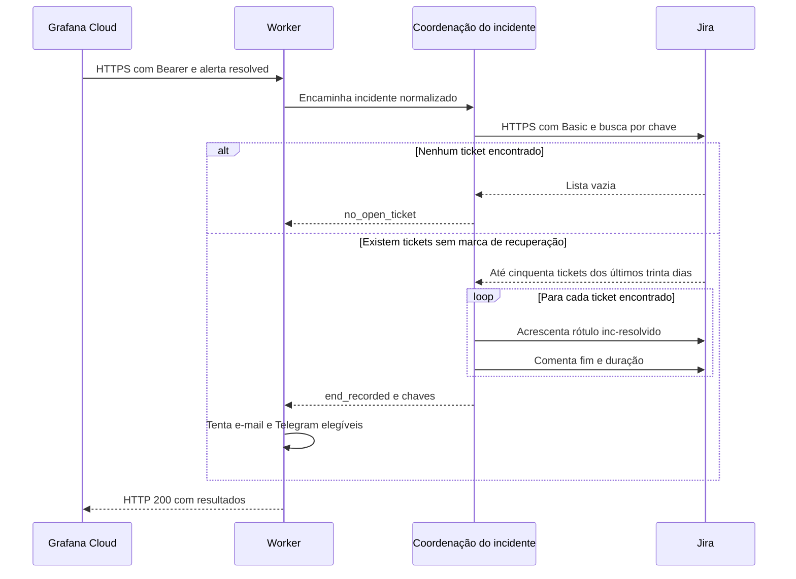

  

# Registro de recuperação

Quando chega um alerta `resolved`, a coordenação procura tickets do mesmo projeto e chave que ainda não tenham o rótulo de recuperação. O fim do alerta fica registrado sem alterar o status do atendimento. A implementação está em [service.ts](https://github.com/Solierrr/worker-alerts/blob/main/src/incident/service.ts).

## Casos de erro

A recuperação e o fechamento do atendimento têm efeitos diferentes.

- Se o ambiente diverge, a ação é `ignored_env`.
- Uma falha de busca, marcação ou comentário devolve 503 pelo webhook. Uma escrita anterior pode já ter ocorrido.
- A pausa não bloqueia os sinais de recuperação recebidos do Grafana.
- O status do ticket continua dependente de decisão humana, e o encerramento é feito manualmente pelos desenvolvedores.
