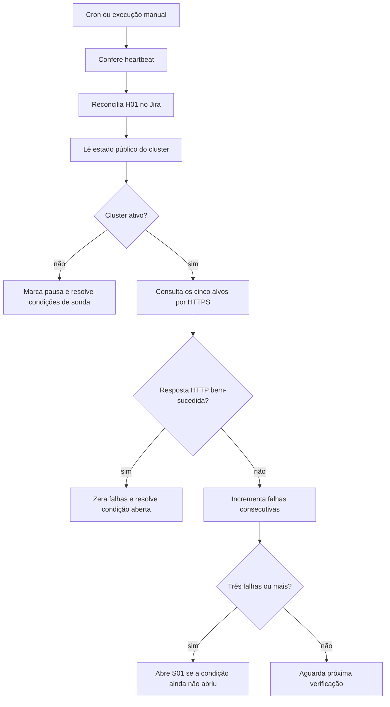

  

# Verificação independente

O cron da Cloudflare ou a chamada autenticada a `/monitor/run` confere a chegada do heartbeat e os alvos públicos. Só as mudanças de condição abrem ou registram recuperação no Jira. A implementação está em [monitor.ts](https://github.com/Solierrr/worker-alerts/blob/main/src/monitor/monitor.ts).

O heartbeat gera H01, P1 para `grafana-cloud`, quando a idade passa de quinze minutos. Antes da primeira batida, usa o instante da primeira verificação como referência. As sondas geram S01, P1 para o serviço do alvo, após três falhas consecutivas. Uma resposta boa registra recuperação. Os incidentes do monitor seguem direto para a coordenação Jira, sem passar pelo canal de e-mail do webhook.

## Casos de erro

As verificações consultam caminhos e dados versionados.

- Timeout, erro de rede, redirect ou HTTP fora de 2xx contam como falha da sonda.
- Se `ephemerality.json` não puder ser lido ou não tiver `active=false`, o monitor assume cluster ativo.
- A leitura da pausa não depende do Grafana Cloud, e o heartbeat continua sendo conferido com o cluster pausado.
- Uma falha no Jira interrompe a execução antes de registrar a transição correspondente no storage.
- Cron e execução manual podem se sobrepor. Não há trava global de monitor no código.

Os alvos e limites estão em [ARCHITECTURE.md](../docs/ARCHITECTURE.md) e [DURABLE_OBJECTS.md](../database/DURABLE_OBJECTS.md).
