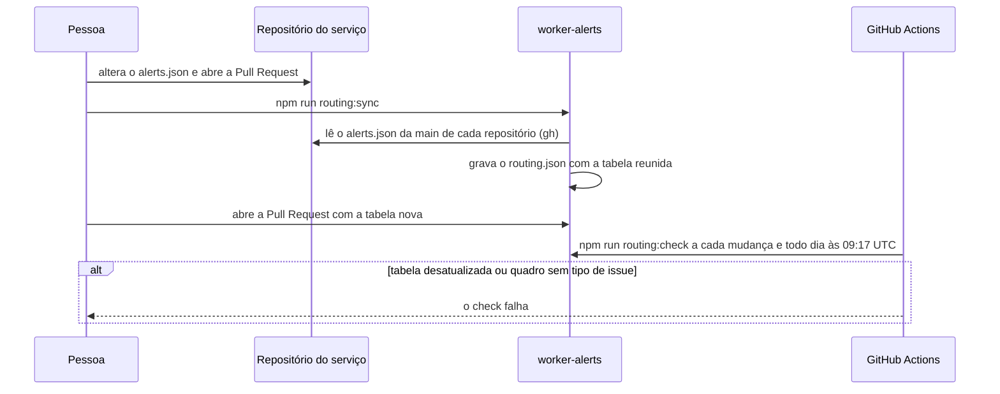

  

# Sincronização das rotas

Acontece quando alguém muda o destino de um serviço ou cria um serviço novo. O destino é declarado no `alerts.json` da raiz do repositório do serviço, e este repositório guarda uma cópia reunida dessas declarações, conferida no CI e todos os dias, para que o Worker publicado use sempre a tabela revisada.

Os componentes que não têm repositório próprio, como o banco de grafos, o gateway, o cluster, o monitoramento e a entrega contínua, ficam numa tabela compartilhada mantida aqui.
