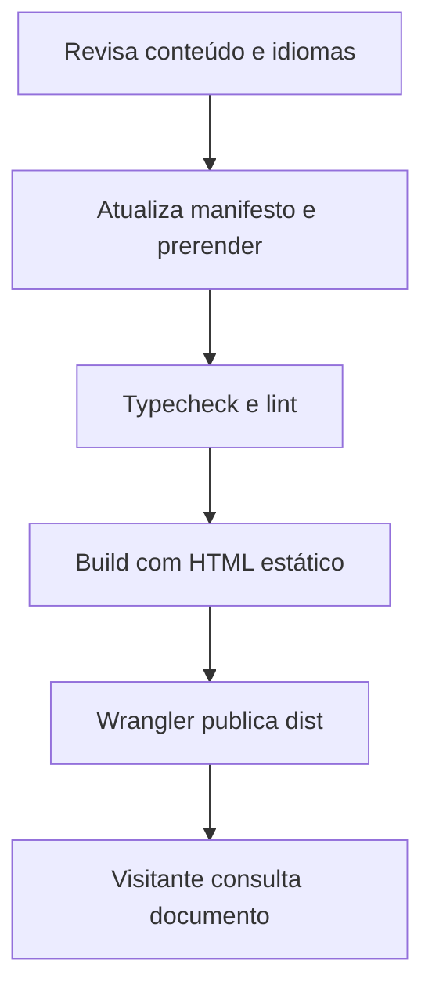

  

# Publicação de conteúdo

O conteúdo JSON é validado e incluído no build antes da publicação no domínio público.

Um JSON inválido, a falta do tarball ou uma falha de build impedem a entrega, e a falta de autorização no Cloudflare impede a publicação, enquanto os documentos sem tradução usam o idioma padrão.